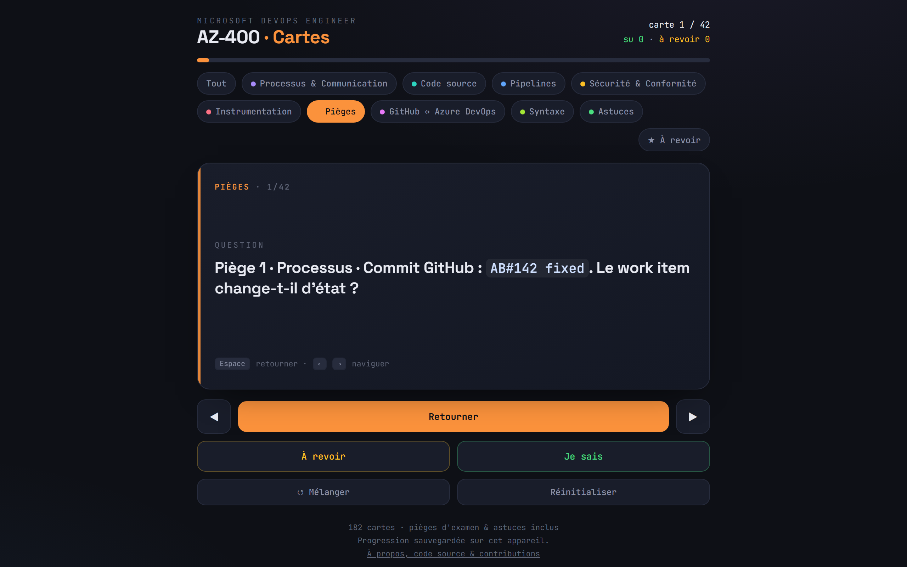

# AZ-400 · Cartes de révision

> 🇬🇧 *Free French-language flashcards app for the Microsoft AZ-400 (DevOps Engineer Expert) certification: 182 cards, 42 exam traps, GitHub vs Azure DevOps side by side, installable PWA, works offline.*

**182 flashcards en français pour préparer la certification [Microsoft AZ-400](https://learn.microsoft.com/fr-fr/credentials/certifications/devops-engineer/) (DevOps Engineer Expert)**, organisées selon les 5 domaines officiels de l'examen, dont 42 pièges issus pour la plupart d'erreurs réellement commises en préparation. Gratuit, open source, sans inscription, sans tracking.

[](https://anisanis-b.github.io/az400-flashcards/revision.html)
[](https://anisanis-b.github.io/az400-flashcards/)




## Pourquoi ces cartes ?

Les questions de l'AZ-400 ne testent pas ta capacité à réciter la doc : elles ciblent **les détails contre-intuitifs** et **les confusions entre deux plateformes**. Le `rebase` qui réécrit les SHA des commits. Les jobs GitHub Actions qui partent **en parallèle** sans `needs`. Les **6 h** d'un job GitHub contre les **60 min** d'Azure Pipelines gratuit. Le `${{ if }}` évalué **à la compilation**, avant même que le pipeline ne démarre. Slack qui se branche par un **service hook**, pas par une notification.

Les cartes « Piège » viennent de la préparation elle-même : les erreurs que j'ai réellement commises, et les confusions relevées en chemin. Réviser ces cartes, c'est faire les erreurs **avant** l'examen plutôt que pendant.

## Fonctionnalités

- 🃏 **Rappel actif** : un cas concret au recto, une réponse courte au verso (la réponse en gras, puis le pourquoi en une phrase). Tu réponds avant de retourner.
- 🗂️ **Les 5 domaines officiels de l'examen + 4 paquets transversaux** : Processus & Communication, Code source, Pipelines, Sécurité & Conformité, Instrumentation, plus les Pièges d'examen, GitHub ↔ Azure DevOps, la Syntaxe et les Astuces réflexes.
- ⚖️ **GitHub et Azure DevOps côte à côte** : l'examen exige les deux et adore les mélanger. Un paquet entier met leurs notions face à face.
- ⭐ **« Je sais » / « À revoir »** : progression sauvegardée sur l'appareil (localStorage), avec un mode qui ne fait tourner que tes lacunes.
- 📱 **PWA installable** : « Ajouter à l'écran d'accueil » sur Android/iOS. Plein écran, icône dédiée, **fonctionne hors ligne**.
- 🔀 **Mélange, navigation au swipe** (mobile) **et au clavier** (desktop).
- 🪶 **Un seul fichier HTML par page, zéro dépendance, zéro compte, zéro tracking.**

## Contenu

| Paquet (intitulés officiels de l'examen) | Cartes | Poids à l'examen | Ce que ça couvre |
|---|---:|---:|---|
| 🧭 Concevoir et implémenter des processus et des communications | 10 | 10-15 % | Area et Iteration Paths, modèles de processus, GitHub Projects, burnup, liens `AB#`, wikis, Mermaid, intégration Teams |
| 🌿 Concevoir et implémenter une stratégie de contrôle de code source | 11 | 10-15 % | Trunk-based, GitFlow, rebase, commits atomiques, branch policies, hooks, inner source et forks, `git reflog` |
| 🚀 Concevoir et implémenter des pipelines de build et de mise en production | 52 | 50-55 % | Tests, agents et parallel jobs, YAML, templates, ressources, gates, blue-green, canary, anneaux, feature flags, ARM, Bicep, runbooks, santé des pipelines, Azure Artifacts, GitHub Packages, SemVer |
| 🔐 Développer un plan de sécurité et de conformité | 32 | 10-15 % | Service principals, managed identities, GitHub Apps, connexions de service, SAST et DAST, STRIDE, CodeQL, Dependabot, licences, SBOM, Defender for Cloud, Azure Policy, verrous, GitHub Advanced Security |
| 📈 Implémenter une stratégie d'instrumentation | 13 | 5-10 % | Azure Monitor, Log Analytics, Application Insights, seuils dynamiques, Smart Detection, workbooks, KQL, Container Insights, ITSMC, alertes actionnables |
| 🎯 **Pièges d'examen** | 42 | transversal | Les confusions et exceptions que les questions pièges adorent, groupées par thème |
| ⚖️ GitHub ↔ Azure DevOps | 6 | transversal | La même notion sur les deux plateformes : ce qui se correspond, ce qui diffère |
| ⌨️ Syntaxe et commandes | 4 | transversal | La commande Git, le mot-clé YAML, KQL ou Bicep à reconnaître dans un extrait |
| ⚡ Astuces réflexes | 12 | transversal | Mot-clé de l'énoncé → réponse attendue |

> ℹ️ Les pièges sont numérotés et groupés par thème, avec le thème rappelé sur chaque carte (ex : « Piège 12 · Pipelines · … »).

## Périmètre : ce que ces cartes ne couvrent pas

Ces cartes sont tirées de mes fiches de révision. Elles couvrent ce que j'ai réellement travaillé, pas l'intégralité du [guide d'étude officiel](https://learn.microsoft.com/fr-fr/credentials/certifications/resources/study-guides/az-400). Sujets au programme, **absents du paquet** :

- Azure Deployment Environments et Azure Machine Configuration en détail
- git-fat et la migration d'un pipeline Classic vers YAML
- La génération de documentation à partir de l'historique Git
- Le suivi distribué

Pour ces sujets, complète avec [Microsoft Learn](https://learn.microsoft.com/fr-fr/credentials/certifications/devops-engineer/). Les contributions qui comblent ces trous sont les bienvenues.

## Utilisation

- **En ligne** : [anisanis-b.github.io/az400-flashcards/revision.html](https://anisanis-b.github.io/az400-flashcards/revision.html)
- **Hors ligne / local** : télécharge `revision.html` et ouvre-le dans n'importe quel navigateur, tout est autonome.

### Installer comme une app (recommandé)

L'outil est une PWA : une fois installée, elle se lance depuis sa propre icône, en plein écran, et fonctionne **sans connexion**. Idéal pour réviser dans les transports.

| Appareil | Comment installer (30 secondes) |
|---|---|
| **Android** (Chrome) | Ouvre la [page de révision](https://anisanis-b.github.io/az400-flashcards/revision.html) → menu **⋮** → **« Ajouter à l'écran d'accueil »** (ou « Installer l'application ») |
| **iPhone / iPad** (Safari) | Ouvre la page de révision → bouton **Partager** → **« Sur l'écran d'accueil »** |
| **PC / Mac** (Edge ou Chrome) | Ouvre la page de révision → icône **« Installer l'application »** à droite de la barre d'adresse → l'app s'épingle à la barre des tâches ou au Dock |

La progression (« je sais » / « à revoir ») est sauvegardée séparément sur chaque appareil.

### Raccourcis clavier

| Touche | Action |
|---|---|
| `Espace` | Retourner la carte |
| `←` / `→` | Carte précédente / suivante |
| `J` | Marquer « je sais » |
| `R` | Marquer « à revoir » |
| `S` | Mélanger |

## Contribuer

Une carte fausse ? Un piège qui t'a eu à l'examen blanc et qui manque ici ? **Les issues et pull requests sont bienvenues.**

Ajouter une carte = ajouter une ligne dans le tableau `CARDS` de [`revision.html`](revision.html) : un cas concret au recto, la réponse en gras puis une phrase d'explication au verso.

```js
{d:"pie",  // paquet : proc · src · pip · sec · ins · pie · eqv · cmd · tip
 q:"Piège 43 · Git · Le cas concret, côté recto ?",
 a:"<b>La réponse.</b> Pourquoi, en une phrase."},
```

Merci de sourcer les faits vérifiables (doc Microsoft Learn ou GitHub Docs) dans la description de la PR.

## Stack

HTML + CSS + JavaScript vanilla, un fichier par page. Pas de framework, pas de build, pas de dépendance. La progression vit dans `localStorage` (clé `az400-progress-v1`), le mode hors ligne dans un petit service worker ([`sw.js`](sw.js)).

## Licence & marques

Code et contenu sous licence [MIT](LICENSE). Projet indépendant, **non affilié à Microsoft**. AZ-400, Azure, Azure DevOps et Microsoft sont des marques de Microsoft Corporation. GitHub est une marque de GitHub, Inc. Les informations reflètent l'état des services au moment de la rédaction (2026) : vérifie toujours la doc officielle ([Azure DevOps](https://learn.microsoft.com/fr-fr/azure/devops/), [GitHub](https://docs.github.com/fr)) en cas de doute.

---

*Fait par [@AnisAnis-b](https://github.com/AnisAnis-b) pendant sa préparation de l'AZ-400. Du même auteur : [cartes de révision AZ-104](https://github.com/AnisAnis-b/az104-flashcards). Si ces cartes t'aident, une ⭐ fait toujours plaisir.*
